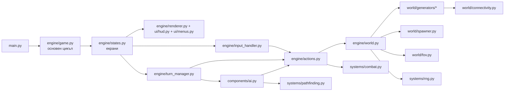
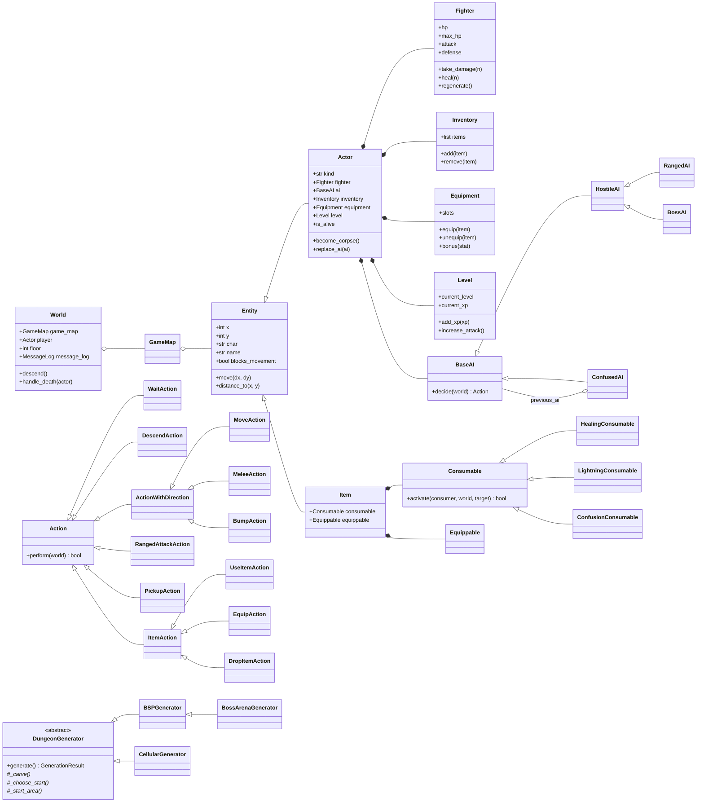
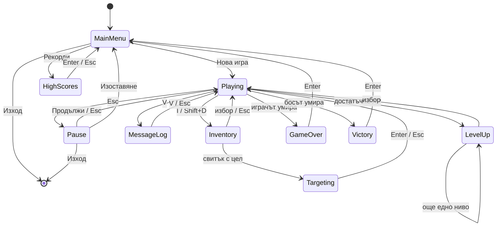
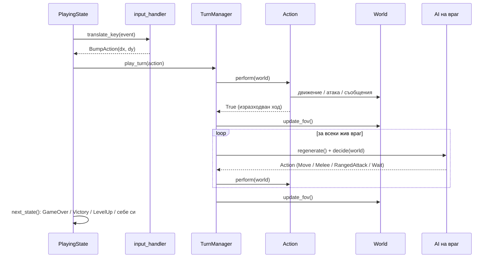

# Архитектура

## 1. Общ преглед

Проектът е разделен на **два слоя**:

| Слой | Пакети | pygame? | Отговорност |
|---|---|---|---|
| **Логика** | `world/`, `systems/`, `components/`, `entities/`, `engine/world.py`, `engine/actions.py`, `engine/turn_manager.py`, `engine/camera.py`, `ui/message_log.py`, `ui/highscores.py`, `config.py` | **не** | правила на играта, генерация, алгоритми |
| **Представяне** | `main.py`, `engine/game.py`, `engine/states.py`, `engine/input_handler.py`, `engine/renderer.py`, `engine/smoke.py`, `ui/hud.py`, `ui/menus.py` | да | прозорец, вход, рисуване, екрани |

Логиката не знае нищо за pygame. Затова всички алгоритми се тестват с pytest без
прозорец, а представянето само „чете“ `World` и му подава действия.



## 2. Модули

| Файл | Съдържание |
|---|---|
| `main.py` | Входна точка; аргументи `--seed` и `--smoke N`. |
| `config.py` | **Всички** константи: размери, цветове, клавиши, баланс, таблици с врагове и предмети. |
| `engine/game.py` | `Game`: прозорец, 60 FPS цикъл, текущ `State`. |
| `engine/states.py` | Екраните (State pattern): меню, игра, инвентар, насочване, ниво, пауза, лог, рекорди, край. |
| `engine/input_handler.py` | Клавиш → `Action` или `Command`. |
| `engine/actions.py` | Действия (Command pattern): Move, Melee, Bump, RangedAttack, Wait, Pickup, UseItem, Equip, DropItem, Descend. |
| `engine/turn_manager.py` | Един ход: играч → FOV → всички врагове → FOV. |
| `engine/world.py` | `World`: картата, играчът, логът, етажът, seed-ът, статистиката; генериране на етаж. |
| `engine/camera.py` | Каква част от картата се вижда на екрана. |
| `engine/renderer.py` | Рисуване на тайлове и обекти (с кеш на символите). |
| `engine/smoke.py` | Headless smoke test на истинската игра. |
| `world/tile.py` | `TileType` (проходим, прозрачен, символ, цветове). |
| `world/game_map.py` | `GameMap`: тайлове `[x][y]`, обекти, `visible` и `explored`. |
| `world/generators/base.py` | `Rect`, `GenerationResult`, абстрактен `DungeonGenerator` (шаблонен метод). |
| `world/generators/bsp.py` | `BSPGenerator`, `BossArenaGenerator`. |
| `world/generators/cellular.py` | `CellularGenerator`. |
| `world/connectivity.py` | BFS, flood fill, свързани региони, най-далечна точка. |
| `world/fov.py` | Recursive shadowcasting, линия на Брезенхам, линия на видимост. |
| `world/spawner.py` | Претеглено разполагане на врагове и предмети по етаж. |
| `entities/entity.py` | `Entity` (позиция, символ, цвят, име, блокира ли). |
| `entities/actor.py` | `Actor(Entity)` с компоненти. |
| `entities/item.py` | `Item(Entity)` с `consumable` или `equippable`. |
| `entities/factories.py` | Създаване на играча, враговете и предметите по таблиците в `config`. |
| `components/fighter.py` | HP, атака, защита (базови стойности + бонуси), щета, лечение, регенерация. |
| `components/ai.py` | `HostileAI`, `RangedAI`, `BossAI`, `ConfusedAI`. |
| `components/inventory.py` | Раница с капацитет. |
| `components/equipment.py`, `components/equippable.py` | Слотове (оръжие, броня) и бонуси. |
| `components/consumable.py` | Лечение, мълния, объркване. |
| `components/level.py` | Опит и нива. |
| `systems/pathfinding.py` | A*. |
| `systems/combat.py` | Формула за щета, критичен удар, пропуск. |
| `systems/rng.py` | Централизиран random и производни seed-ове. |
| `ui/message_log.py` | Лог (повтарящите се съобщения се обединяват). |
| `ui/highscores.py` | Рекорди в JSON (атомарен запис, валидиране). |
| `ui/hud.py`, `ui/menus.py` | Долният панел и прозорците с менюта. |

## 3. Диаграма на класовете



## 4. State machine на екраните



Всеки екран има само два метода: `handle_event(event) -> State | None` и
`render(renderer)`. `Game` просто пази текущия екран и го сменя, ако `handle_event` върне
нов. Подекраните (инвентар, пауза, лог, ниво) пазят референция към `PlayingState` и се
връщат към него, затова играта „отдолу“ не се губи.

## 5. Един ход (последователност)



Ако действието на играча е невалидно (например ход в стена), `perform` връща `False` и
враговете **не** получават ход.

## 6. Алгоритми

Означения: `W×H` е размерът на картата (80×45 = 3600 клетки), `V = W·H`, `r` е радиусът
на FOV.

### 6.1 BSP генератор (`world/generators/bsp.py`)

```
split(node, depth):
    if depth ≥ MAX_DEPTH: return                       # листо
    vertical = w/h > 1.25 ? да : h/w > 1.25 ? не : depth четно
    if страната < 2·MIN_LEAF: пробвай другата посока; ако и тя е малка → листо
    cut = случайно в [40%, 60%] от страната (но ≥ MIN_LEAF от двата края)
    node.left, node.right = двете части
    split(left, depth+1); split(right, depth+1)

create_rooms(node):  листо → стая със случаен размер ≥ 5×5, с отстъп 1 от ръба на листото

connect(node):       (след обхождане на децата)
    (a, b) = най-близката двойка стаи: a от лявото поддърво, b от дясното
    L-образен коридор от центъра на a до центъра на b (случайно кой ъгъл)
```

- **Защо стаите не се застъпват:** всяка стая е вътре в своето листо, а листата
  са непресичащи се части на картата.
- **Защо картата е свързана:** доказва се по индукция. Всеки вътрешен възел свързва двете
  си половини, а те по индуктивното предположение вече са свързани вътрешно.
- **Сложност:** O(W·H) за издълбаването. При L листа намирането на най-близките двойки е
  общо O(L²), защото всяка двойка листа се сравнява точно веднъж, при най-близкия им общ
  прародител. Коридорите струват O(L·(W+H)).
- **Етаж 10 (`BossArenaGenerator`):** коренът се разделя ръчно. Лявата част (45%) е
  обикновено BSP, а дясната е едно листо с голяма зала 30×25. Свързването е същото,
  затова залата е гарантирано достижима.

### 6.2 Cellular Automata (`world/generators/cellular.py`)

```
repeat до CA_MAX_ATTEMPTS пъти:
    стена[x][y] = рамка ИЛИ random() < 0.45
    for i in 0..4:
        за всяка вътрешна клетка: n = стени в 3×3 (извън картата се брои за стена)
            нова_стена = n ≥ 5  ИЛИ  (i < 2 И n == 0)
    региони = find_regions(подове);  най-голям = региони[0]
    if |най-голям| ≥ 40% от W·H: всичко извън него = стена; return
    rng = нов генератор със seed = rng.randrange(...)   # детерминистичен под-seed
```

- Правилото „≥ 5 стени“ изглажда шума. Правилото „0 стени“ в първите 2 итерации
  „засажда“ колони в големите празни зали.
- Новото състояние се смята в **нов** масив, за да не влияе на съседите в същата итерация.
- **Сложност:** O(k·9·W·H) за k итерации плюс O(W·H) за регионите, за всеки опит. На
  практика са нужни 1–5 опита.

### 6.3 Свързаност (`world/connectivity.py`)

```
bfs_distances(passable, start):
    dist = {start: 0}; queue = [start]
    while queue: взимаме cur; за всеки 4-съсед n, проходим и непосетен:
        dist[n] = dist[cur] + 1; добавяме n в опашката
```

- Използва се **4-посочна** свързаност. Тя е по-строга от 8-посочната, затова е
  гаранция и при движение по диагонал.
- Приложения: (1) пазим само най-големия регион в пещерите, (2) стълбите са в
  най-далечното място, (3) `verify_floor` проверява, че стълбите и **всички предмети**
  са достижими от старта след всяка генерация.
- **Сложност:** O(V) = O(W·H), защото всяка клетка влиза в опашката най-много веднъж.

### 6.4 Field of View: recursive shadowcasting (`world/fov.py`)

```
compute_fov(origin, r):
    visible = {origin}
    за всеки от 8-те октанта (множители xx, xy, yx, yy):
        cast_light(ред=1, start_slope=1.0, end_slope=0.0)

cast_light(ред, start, end):
    for distance = ред .. r:
        for всяка клетка в реда (dx от -distance до 0):
            left, right = наклоните на ръбовете на клетката
            пропусни, ако е извън клина [end, start]
            ако dx²+dy² ≤ r²: visible.add(клетката)
            ако предишната беше стена и тази не е: start = new_start (клинът се стеснява)
            ако тази е стена и предишната не беше:
                cast_light(distance+1, start, left)   # частта преди стената – рекурсивно
                new_start = right
        ако редът завърши на стена: край (всичко нататък е в сянка)
```

- Октантите се обработват от **една** функция, като координатите се „завъртат“ с 4
  множителя.
- `visible` се смята наново на всеки ход, а `explored |= visible`.
- **Сложност:** O(r²). Всяка клетка в радиуса се посещава практически веднъж на октант.
  При r = 8 това са около 200 клетки, тоест много по-малко от цялата карта.
- Отделно `bresenham_line` (O(разстояние)) дава правата линия за стрелците.

### 6.5 A* (`systems/pathfinding.py`)

```
open = min-купчина с (f = g + h, брояч, клетка);  g[start] = 0
while open:
    cur = pop()
    if cur == goal: върни възстановения път
    if cur е затворена: continue       # остарял запис в купчината
    затвори cur
    за всеки проходим 8-съсед n:
        цена = 1 + (10, ако n е заета от друго същество)
        if g[cur] + цена < g[n]: g[n] = …; came_from[n] = cur; push(n, g[n] + h(n))
return None                              # недостижимо
```

- Евристиката е **Chebyshev** `h = max(|dx|, |dy|)`. При 8 посоки и цена 1 на стъпка тя
  е точно минималният брой ходове без препятствия, тоест никога не надценява
  (admissible) и A* намира най-кратък път.
- Заетите клетки **не са забранени**, а са скъпи (+10). Така враговете заобикалят, когато
  има обход, но не се блокират в коридор с ширина 1.
- **Сложност:** O(E log V) с двоична купчина, където E ≤ 8V. Тоест O(V log V) в най-лошия
  случай, но обикновено много по-малко, защото евристиката насочва търсенето.
- **Памет на враговете:** преследването е само ако врагът е във FOV на играча, или го е
  видял в последните `AI_MEMORY_TURNS = 5` хода (тогава върви към последната позиция).

### 6.6 Бойна система (`systems/combat.py`)

```
if random() < 5%: пропуск (0 щета)
щета = max(1, атака − защита) + randint(−1, +1);  щета = max(1, щета)
if random() < 5%: щета ×= 2 (критичен удар)
```

Сложност O(1). Щетата при попадение е **винаги ≥ 1** (има тест с 500 хвърляния за
различни комбинации).

### 6.7 Спаунване (`world/spawner.py`)

- Таблиците са във вида `{вид: {от_етаж: тегло}}` и важи последният праг ≤ етажа.
- Изборът е **претеглен**: `random.choices(видове, weights)`, тоест вероятността е
  тегло / сума. Сложност O(k) за k вида.
- Броят е между max/2 и max според етажа. Враговете не се появяват в стартовата зона и
  на стълбите.

### 6.8 Прогресия (`components/level.py`)

XP за следващо ниво = `LEVEL_UP_BASE · ниво · 1.5`. Излишният опит се пренася в
следващото ниво. Ако XP стига за няколко нива, екранът за избор се показва няколко пъти.

## 7. Детерминизъм

```
map_seed(етаж)   = SHA-256(f"{seed}:map:{етаж}")
spawn_seed(етаж) = SHA-256(f"{seed}:spawn:{етаж}")
gameplay_rng     = Random(SHA-256(f"{seed}:gameplay"))
```

Картата и съдържанието на всеки етаж имат **собствен** генератор. Затова етаж 5 е един
и същ, независимо колко пъти си се бил на етажи 1–4. Използва се SHA-256, а не
вграденият `hash()`, защото `hash()` на низове е различен при всяко стартиране на Python.

## 8. Използвани design patterns

| Pattern | Къде |
|---|---|
| **Command** | `engine/actions.py`: и играчът, и AI-то създават `Action` обекти. |
| **State** | `engine/states.py`: всеки екран е клас. |
| **Composition** (Entity–Component) | `Actor` с `Fighter`, `AI`, `Inventory`, `Equipment`, `Level`; `Item` с `Consumable` или `Equippable`. |
| **Template Method** | `DungeonGenerator.generate()`: общият алгоритъм е в базовия клас, а стъпките в наследниците. |
| **Decorator** | `ConfusedAI` обгръща истинското AI и го връща след N хода. |
| **Factory** | `entities/factories.py`: обекти по таблиците в `config`. |
| **Data-driven design** | Всички врагове, предмети и баланс са данни в `config.py`. |
