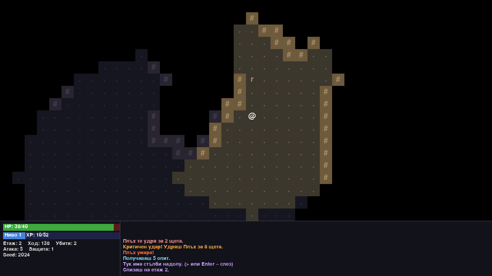

# Подземията на краля – roguelike на Python

2D roguelike игра с процедурно генерирани подземия, написана на Python с `pygame-ce`
като университетски проект. Изгледът е отгоре, върху мрежа от тайлове. Играта върви на
ходове (turn-based): светът се движи само когато играчът направи действие. Смъртта е
окончателна (permadeath). Целта е да слезеш до **етаж 10** и да победиш
**Краля на подземието**.



**Какво има на скрийншота (етаж 2, пещера):**
- Отгоре е картата. Светлите клетки са в зрителното поле на играча (`@`). Тъмносиньото е
  вече изследвано, но в момента не се вижда. Черното е неизследвано.
- `#` са стени, `.` е под, а `r` е плъх.
- Долу вляво е HUD-ът: лента за живота (HP), лента за опита (XP) и ниво. Под тях са
  етажът, изиграните ходове, убитите врагове, атаката, защитата и seed-ът на картата.
- Долу вдясно са последните съобщения в цвят (атаки, критични удари, смърт, опит).
- Цялата графика се рисува програмно (цветни квадрати и символи с вградения шрифт на
  pygame). Играта не ползва никакви външни графични файлове.

## Възможности

- **Два генератора на карти.** Нечетните етажи са BSP подземия със стаи и коридори,
  четните са пещери, направени с Cellular Automata. Етаж 10 е арена с бос.
- **Детерминизъм.** Една и съща seed стойност дава една и съща карта
  (`python main.py --seed 12345`).
- **Зрително поле.** Използва recursive shadowcasting с радиус 8, а изследваните зони се
  помнят.
- **Изкуствен интелект.** Враговете търсят път с A*. Стрелците държат дистанция и стрелят
  по права линия. Тролът регенерира. Босът има 2 фази и призовава гоблини.
- **Предмети и екипировка.** Има отвари, свитък на мълнията, свитък на объркването с
  избор на цел, 3 оръжия и 3 брони.
- **Прогресия.** Опитът носи нива, а при всяко ниво избираш подобрение: +20 HP,
  +1 атака или +1 защита.
- **Рекорди.** Пази се топ 10 в `data/highscores.json`, а повреден файл не срива играта.

## Инсталация

Нужен е Python 3.11 или по-нов (разработено и тествано на 3.14 под Windows).

**Windows (PowerShell):**
```powershell
python -m venv .venv
.\.venv\Scripts\Activate.ps1
pip install -r requirements.txt
```

**macOS / Linux:**
```bash
python3 -m venv .venv
source .venv/bin/activate
pip install -r requirements.txt
```

## Стартиране

```bash
python main.py                 # нормална игра
python main.py --seed 12345    # първата игра е с фиксиран seed (повторима карта)
python main.py --smoke 200     # headless smoke test: 200 случайни натискания без прозорец
```

## Контроли

| Клавиш | Действие |
|---|---|
| Стрелки / `W A S D` + `Q E Z C` / numpad / `Home PgUp End PgDn` | движение в 8 посоки (движението към враг е атака) |
| `.` / `Space` / numpad `5` | изчакай един ход |
| `G` | вдигни предмет |
| `I` | инвентар (`a`–`z` използва предмет; оръжие или броня се слага или сваля) |
| `Shift + D` | изхвърли предмет (малкото `d` е движение надясно) |
| `>` или `Enter` върху стълбите | слез на следващия етаж |
| `V` | пълен лог на съобщенията (стрелки и PageUp/PageDown превъртат) |
| `Esc` | пауза: продължи, изоставяне или изход |

При свитъка на объркването курсорът се мести със стрелките, `Enter` избира цел, а
`Esc` отказва.

## Тестове

```bash
python -m pytest -v
```

Има 248 теста. Те покриват генераторите, свързаността, FOV, A*, бойната система,
инвентара, прогресията, рекордите, клавишите и headless smoke тестове на истинската игра.
Включени са и 3 пълни игри от етаж 1 до победата, изиграни от бот. Логическите модули не
импортират pygame и се тестват без прозорец.

## Документация

- [ARCHITECTURE.md](ARCHITECTURE.md): модулите, диаграмите и алгоритмите (с псевдокод
  и сложност).
- [DEFENSE.md](DEFENSE.md): вероятни въпроси при защитата и отговори.
- [PROGRESS.md](PROGRESS.md): какво е направено във всеки етап.
- [CLAUDE.md](CLAUDE.md): конвенциите на кода.
